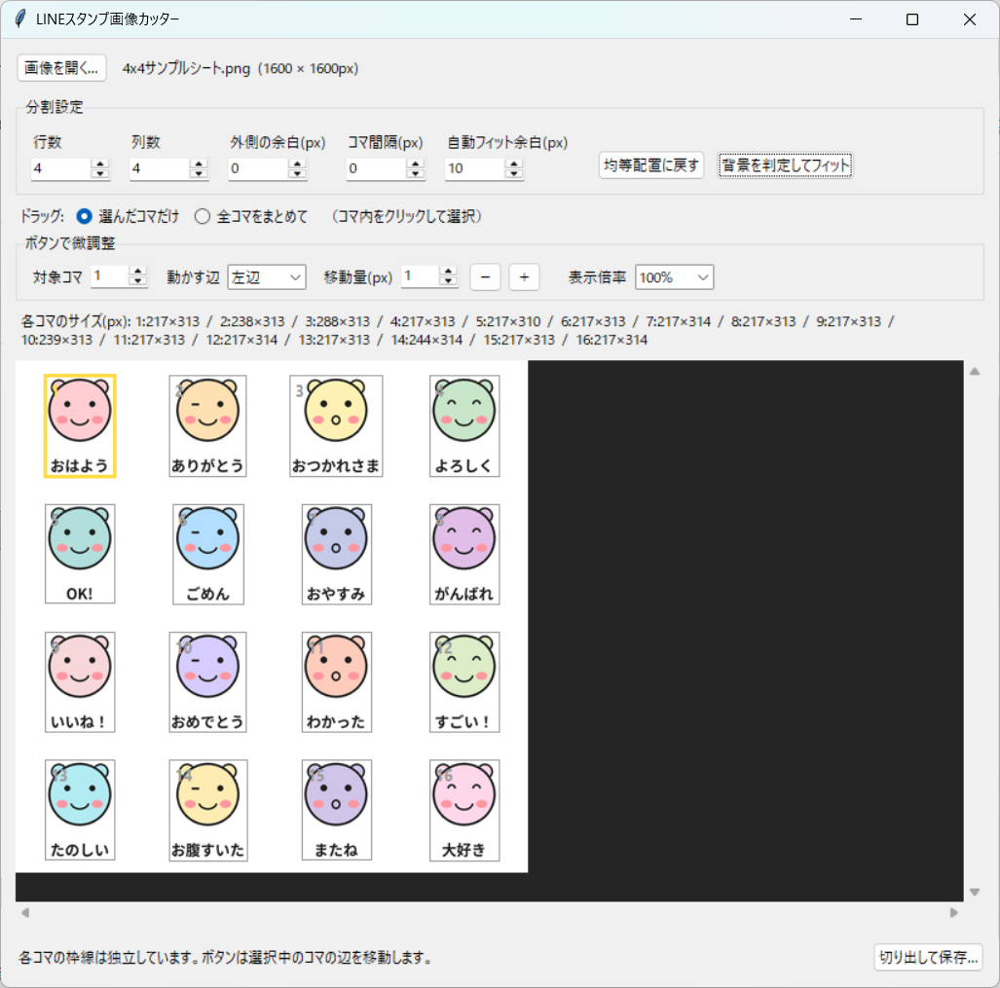

# LINE Stamp Cutter — LINEスタンプ画像分割ツール

スタンプシート（1枚にまとまった画像）をコマごとに切り出し、枠の微調整や背景の透明化をして、LINEスタンプ用のPNGとZIPを書き出すWindowsアプリです。

**プログラミング不要。exeファイルをダウンロードして実行するだけです。**

## ダウンロード

👉 **[最新版 v1.0.0 をダウンロード（LINEStampCutter.exe）](https://github.com/nanashiaa-lab/line-stamp-cutter/releases/download/v1.0.0/LINEStampCutter.exe)**

- Windows用、Pythonのインストールは不要です
- すべてのリリースは [Releases](https://github.com/nanashiaa-lab/line-stamp-cutter/releases) からも取得できます

## スクリーンショット

<!-- ↓ X投稿に使った修正済みスクリーンショットを screenshot.png という名前でこのREADMEと同じ場所に置くと表示されます -->


<!-- ビフォーアフター画像（シート → 分割後）があると、さらに伝わりやすくなります -->

## 特長

- 行×列を指定してシートをコマごとに分割
- 各コマの枠を個別に微調整、ズーム表示で確認
- 背景を判定して枠を自動フィット
- 背景の透明化（既存の透明部分はそのまま保持）
- LINE規格に合わせた書き出し
  - スタンプ画像：最大370×320px、縦横とも偶数サイズのPNG
  - `main.png`（240×240）と `tab.png`（96×74）も自動生成
  - `line_stickers.zip` にまとめて出力（画像はZIPの直下に配置）

## 使い方

1. 上のリンクから `LINEStampCutter.exe` をダウンロードして実行
2. スタンプシートの画像を読み込む
3. 行と列の数を指定して分割
4. 必要に応じて各コマの枠を微調整し、背景の透明化を確認
5. LINE用PNGとZIPを書き出す

## ソースから実行する場合

Python 3.10以上（Windows）が必要です。

```powershell
py -3 -m pip install -r requirements.txt
py -3 line_stamp_cutter.py
```

## Windowsアプリとしてビルドする場合

`build_windows.bat` をダブルクリックすると、依存関係をインストールして `dist\LINEStampCutter.exe` を作成します。ビルドしたアプリにはPythonとPillowが含まれるため、利用者はPythonをインストールする必要がありません。

## 注意事項

- 既存の透明部分は保持されます。不透明な単色背景や、画像の端につながった市松模様の背景は推定して除去します。特殊な画像では書き出し後に確認してください。
- LINEの通常スタンプは8、16、24、32、40個のいずれかです。PNGは縦横とも偶数サイズ、72dpi以上、1ファイル1MB以下。ZIPは60MB以下です。
- 提出前に [LINE Creators Market スタンプガイドライン](https://creator.line.me/ja/guideline/sticker/) を確認してください（規格は変更される場合があります）。

## ライセンス

MITライセンスです。詳しくは [LICENSE](LICENSE) をご覧ください。
